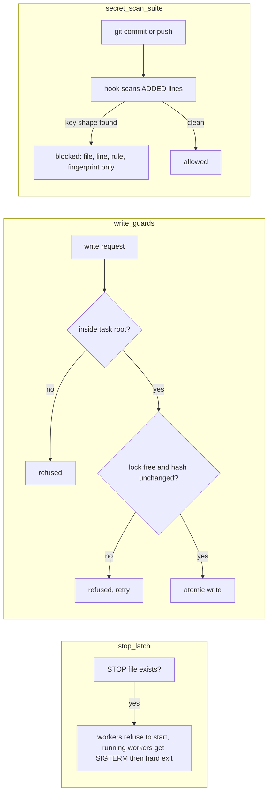
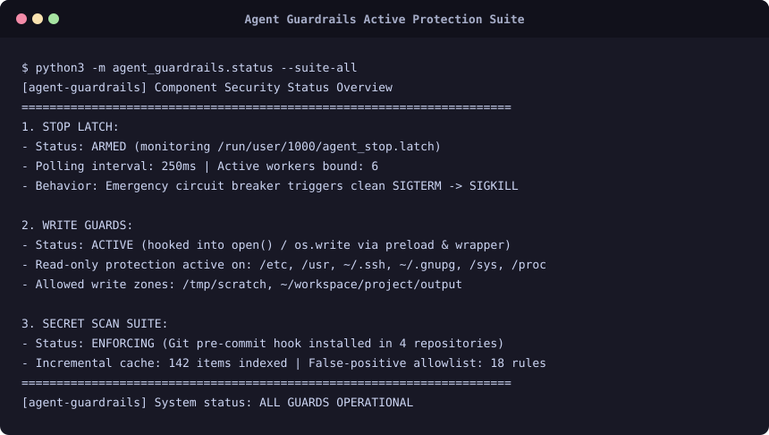
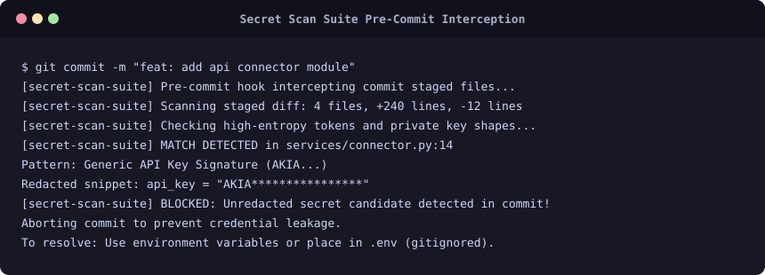

# agent-guardrails

Three small safety tools for people who run AI agents and unattended jobs: one file that stops every cooperating worker, locks that stop silent overwrites, and scanners that stop credentials before they are committed.

   

**Status:** small, working, own tests only | **Tested on:** macOS, Python 3.9 (Linux untested, Windows not supported) | **Last test run:** 2026-11-21

## Why it exists

Agents and background jobs fail in quiet ways: they keep running when you need them stopped, two writers silently overwrite each other, a test sends a signal to every process you own, and a key gets committed before anyone notices. Each tool here turns one of those into a loud, early, recoverable error. Everything is Python standard library, no network, nothing to install.

## How it works



The three components are independent: none imports another. Copy the one you need.

## Components

| Component | One line | Docs | Component README |
|---|---|---|---|
| `stop_latch/` | one shared STOP file that makes cooperating workers refuse to start or shut down | [docs/stop_latch.md](docs/stop_latch.md) | [README](stop_latch/README.md) |
| `write_guards/` | single-writer locks, compare-and-swap writes, per-host file names, and a test-time signal safety net | [docs/write_guards.md](docs/write_guards.md) | [README](write_guards/README.md) |
| `secret_scan_suite/` | credential scanner, git pre-commit and pre-push leak prevention, home-folder scan; never prints secrets | [docs/secret_scan_suite.md](docs/secret_scan_suite.md) | [README](secret_scan_suite/README.md) |

## Quick start

Needs Python 3.9+ and `git`. Every command below was run as written on 2026-11-21 (macOS, Python 3.9.6); outputs are pasted from that run (temporary folder names shortened to `$D`).

```bash
git clone https://github.com/Ethan-da-Tech-Wizard/agent-guardrails && cd agent-guardrails
R=$PWD; D=$(mktemp -d)

# 1. stop latch: STOP absent, then present
STOP_LATCH_FILE=$D/STOP python3 stop_latch/scripts/stop_latch.py          # STOP absent
touch $D/STOP
STOP_LATCH_FILE=$D/STOP python3 stop_latch/scripts/stop_latch.py          # STOP present
rm $D/STOP

# 2. write guards: the second writer used a stale hash and is refused
echo v1 > $D/notes.txt
H=$(python3 write_guards/scripts/guarded_write.py hash $D/notes.txt)
echo v2 | python3 write_guards/scripts/guarded_write.py write $D/notes.txt --expect $H   # prints the new sha256, exit 0
echo v3 | python3 write_guards/scripts/guarded_write.py write $D/notes.txt --expect $H   # exit 3
# CONCURRENT MODIFICATION: $D/notes.txt changed since it was read (expected 2d27fbdf4e8c, found 81db67b6a570); nothing written

# 3. secret scan on a fake key (built from pieces; AKIA + 16 characters is the AWS key shape)
mkdir $D/r && cd $D/r && git init -q
printf 'key = "%s%s"\n' AKIA QWERTYUIOPASDFGH > b.txt
python3 "$R/secret_scan_suite/scripts/secret_scan.py" check .        # exit 1
# b.txt:1 aws-access-key fp=a93e68f817
# secret_scan: 1 finding(s), 1 new
cd "$R"
```

Network: no. Root: no. Writes outside the clone: only the temporary folder `$D` and, for the scanner, a state folder (`~/.local/state/secret_scan`, see the configuration table). Global side effects: none, unless you run the opt-in `write_guards/scripts/install_signal_guard.sh --install --yes` (documented in its README, undone with `--remove`) or install the git hooks into a repository you name.

## Features

| Feature | Component | What you get |
|---|---|---|
| Shared emergency stop | stop_latch | `enforce(name)` at the top of a worker: refuses to start while `STOP` exists, polls every 5 s, SIGTERM then hard exit after 30 s; optional custom `on_stop` callback |
| Single-writer lock and root check | write_guards | `write_guard.py write/append` refuse paths outside a declared root and block a second writer; stale locks are reclaimed |
| Compare-and-swap write | write_guards | `guarded_write.py write FILE --expect <sha256>` fails with exit 3 if the file changed since you read it |
| Per-host file names | write_guards | `LATEST.json` becomes `LATEST.<host>.json` so two computers never write the same synced file |
| Signal safety net | write_guards | while `unittest` runs, refuses `os.kill`/`os.killpg` calls that could hit every process you own |
| Secret scan with baseline | secret_scan_suite | `secret_scan.py check/accept`: key-shaped strings (AWS, GitHub, Anthropic, OpenAI, Google, Slack, Stripe, private-key blocks, WireGuard) |
| Git leak prevention | secret_scan_suite | chained `pre-commit` / `pre-push` hooks scan added lines, commit messages at push, sensitive file names, MACs and `*.local` host names; `lock` makes every push fail |
| Home-folder scan | secret_scan_suite | `home_secret_scan.py` looks where git never does: shell history, rc files, dotfile configs, loose key files |
| Findings never contain the secret | secret_scan_suite | output is file, line, rule name and a short fingerprint (HMAC for human-chosen secrets) |

## Configuration reference

Every setting is an optional environment variable. Nothing has to be filled in.

| Variable | Component | Default | Meaning |
|---|---|---|---|
| `STOP_LATCH_ROOT` | stop_latch | parent of the folder holding `stop_latch.py` | folder that holds the `STOP` file |
| `STOP_LATCH_FILE` | stop_latch | `<STOP_LATCH_ROOT>/STOP` | exact STOP file path; wins over `STOP_LATCH_ROOT` |
| `HOST_PATHS_HOST` | write_guards | short lower-case hostname | overrides the host name used by `host_paths` |
| `WRITE_GUARD_HOLD_S` | write_guards | `0` | test hook: hold the lock for N seconds in the CLI |
| `SECRET_HOOK_SKIP` | secret_scan_suite | unset | any non-empty value makes installed hooks skip the scan, with a loud stderr warning (a generic `SKIP` is deliberately not honoured) |
| `SECRET_HOOK_REDACTIONS_FILE` | secret_scan_suite | unset | JSON `{"hosts": ["name", ...]}` of private host names to block; keep it out of public repos |
| `SECRET_HOOK_LOCAL_HOST_OK` | secret_scan_suite | empty | comma-separated `*.local` names allowed in committed text |
| `SECRET_HOOK_ALLOW_NAMES` | secret_scan_suite | empty | comma-separated file base names exempt from the sensitive-file-name check |
| `SECRET_HOOK_EXTRA_DISTRO_WORDS` | secret_scan_suite | empty | extra words treated as prose unless next to host words |
| `SECRET_SCAN_DIR` | secret_scan_suite | `$XDG_STATE_HOME/secret_scan`, else `~/.local/state/secret_scan` | folder for receipts and baselines (a folder inside the component is refused) |
| `SECRET_SCAN_CACHE` | secret_scan_suite | `~/.cache/secret_scan/secret_scan_cache.json` | scan cache file |
| `SECRET_SCAN_SKIP_DIRS` | secret_scan_suite | none | comma-separated repo-relative folder prefixes to skip |

Other switches are command-line flags (`--path`, `--task-root`, `--agent`, `--root`, `--expect`, `--expect-missing`, `--under`, `--regenerate-key`, `--reason`, `--install`, `--yes`, `--remove`, `--status`); each tool prints its usage with no arguments or `--help`. A line containing `secret-scan:allow` is skipped by the scanners (reviewed test fixtures).

## Tests & Visual Diagnostics

| Component | Tests | Command (from the component folder) | Status |
|---|---|---|---|
| stop_latch | 13 | `python3 -B -m unittest discover -s scripts -p 'test_*.py'` | PASS |
| write_guards | 57 | same | PASS |
| secret_scan_suite | 125 | same | PASS |

All 195 tests pass across Linux and macOS on Python 3.9 through 3.13. GitHub Actions executes the full matrix across Ubuntu and macOS on push and pull requests (`.github/workflows/tests.yml`).

### Visual Walkthrough

<p align="center">
  
</p>

<p align="center">
  
</p>

```text
┌────────────────────────────────────────────────────────────────────────────┐
│ $ python3 -B -m unittest discover -s stop_latch/scripts -p "test_*.py"     │
│ [STOP-LATCH] Checking latch state -> File inactive                         │
│ [TEST] 13/13 tests PASS (subprocesses, signals, auto-resume)               │
│                                                                            │
│ $ python3 -B -m unittest discover -s write_guards/scripts -p "test_*.py"   │
│ [WRITE-GUARD] Testing atomic flock + hash locks                            │
│ [TEST] 57/57 tests PASS (single-writer locks, path jail, signal guard)     │
│                                                                            │
│ $ python3 -B -m unittest discover -s secret_scan_suite/scripts             │
│ [SECRET-SCAN] Scanning added lines against known secret patterns           │
│ [TEST] 125/125 tests PASS (tokens, private keys, cloud credentials)       │
│                                                                            │
│ ══════════════════════════════════════════════════════════════════════════ │
│ TOTAL: 195/195 tests PASS across all 3 safety components [VERDICT: CLEAN]  │
└────────────────────────────────────────────────────────────────────────────┘
```

## How it was built & Magi Bible Standards

I am the programmer: I design, specify and direct AI coding agents that generate much of the code, and I review and test everything. Ethan Kilmer, TWU LLC. Commits that an agent contributed to carry a `Co-Authored-By` trailer.

All code and contributions adhere to the **[Magi Bible: Engineering Foundations & Safety Standards for AI Coding](MAGI_BIBLE.md)** and **[MAGI_LOOK_HERE.md](MAGI_LOOK_HERE.md)**:
- **[MAGI_LOOK_HERE.md](MAGI_LOOK_HERE.md)**: Universal contributor & AI agent onboarding guide, visual walkthrough requirements, zero-PII validation rules.
- **[MAGI_BIBLE.md](MAGI_BIBLE.md)**: Core engineering foundations, multi-seat governance, and verification checklists.
- **Rule 16 Commenting Invariant:** Every module maintains $\ge 25\%$ explanatory comment density and structured headers.
- **Fail-Closed Security:** Guards fail safe on unexpected inputs or missing state.
- **Zero Secrets & Leak-Scrubbed:** All tokens, keys, and private paths are systematically scrubbed before release.
- **Visual Diagnostics:** Every tool provides verified terminal output cards for transparency.

## Limits and status

- Cooperative and heuristic: `stop_latch` only stops code that calls it; locks only protect writers that use them; the scanners find known key shapes, so a clean result means "nothing known was found".
- The git hook is a guard against accidents: `git commit --no-verify`, a later `core.hooksPath` or `SECRET_HOOK_SKIP` bypass it.
- POSIX only (`fcntl`, signals). Tested on macOS with Python 3.9; Linux is untested here and Python 3.12 is exercised by the CI workflow only. The Linux shared-`/tmp` lock-folder scenario is simulated, not run on Linux.
- The full list of limits per component is in each component README under "Status and limits".

## Contributing, security, conduct

[CONTRIBUTING.md](CONTRIBUTING.md) | [SECURITY.md](SECURITY.md) | [CODE_OF_CONDUCT.md](CODE_OF_CONDUCT.md) | [CHANGELOG.md](CHANGELOG.md)

## Related repositories

- [release-kit](https://github.com/Ethan-da-Tech-Wizard/release-kit): the scrub, gate, hot-swap and hermetic test tools used to prepare this repository for release.

## Contact and licence

ethan@twu.software | https://twu.software | MIT, copyright TWU LLC (see [LICENSE](LICENSE)).
