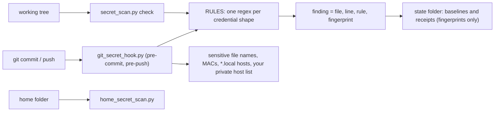

# secret_scan_suite

Three cooperating tools that find credentials without ever printing them: a repository scanner, git hooks that stop a leak before it is committed or pushed, and a scan of the home folder where git never looks. Reference and every limit: [secret_scan_suite/README.md](../secret_scan_suite/README.md).



## Command line

| Command | What it does |
|---|---|
| `secret_scan.py check [PATH]` | scan the current directory or PATH; exit 1 if any new finding |
| `secret_scan.py accept [PATH]` | record current findings as known (rotate real keys first) |
| `git_secret_hook.py install\|uninstall\|status REPO...` | add, remove or report chained `pre-commit` / `pre-push` hooks in the named repositories only |
| `git_secret_hook.py lock REPO` (`unlock` to undo) | make every push from REPO fail |
| `home_secret_scan.py check\|report\|status\|accept FP --reason TEXT` | scan or report on the home folder |

Findings look like `b.txt:1 aws-access-key fp=a93e68f817`. A line containing `secret-scan:allow` is skipped (for reviewed test fixtures).

## How to plug in your own

**1. Add your own credential rule.** `secret_scan.RULES` is a dict of rule name to compiled regex; changing it automatically invalidates the scan cache. This was run on 2026-11-21 (the fixture is built from pieces so the file never holds a whole key-shaped string):

```python
import re, sys
sys.path.insert(0, "path/to/agent-guardrails/secret_scan_suite/scripts")
import secret_scan

secret_scan.RULES["acme-token"] = re.compile(r"(?<![A-Za-z0-9])acme_[0-9a-f]{32}(?![A-Za-z0-9])")
text = "t = " + "acme_" + "0123456789abcdef" * 2 + "\n"
print(secret_scan.scan_text(text))      # [(1, 'acme-token', 'febc8619d3')]
```

To make the rule permanent, add it to `RULES` in `scripts/secret_scan.py` with a comment, and add two tests in `scripts/test_secret_scan.py`: one value that must be found and one look-alike that must not. If the token has a variable length, see `CORE_LEN` and `PLACEHOLDER` in the same file for how placeholder words are ignored.

**2. Install the hook in your repository and block your own private host names.** The host list contains exactly the names you want private, so keep it outside any public repository. Run on 2026-11-21 in a scratch repository with `GIT_CONFIG_GLOBAL=/dev/null` (the installer refuses when `core.hooksPath` is set):

```bash
python3 scripts/git_secret_hook.py install /path/to/repo          # that repository only
echo '{"hosts": ["my-private-box"]}' > ~/private/redactions.json
export SECRET_HOOK_REDACTIONS_FILE=~/private/redactions.json
# a commit that mentions my-private-box now stops:
# secret-hook: p.txt:1 private-hostname -
# secret-hook: BLOCKED commit. Fix: remove it, rotate the credential if it was real, ...
python3 scripts/git_secret_hook.py uninstall /path/to/repo        # undo
```

**3. Allow what you have reviewed.** Add `secret-scan:allow` to a fixture line; list `*.local` names in `SECRET_HOOK_LOCAL_HOST_OK`; list reviewed file base names (for example a project `.npmrc` with no token) in `SECRET_HOOK_ALLOW_NAMES`; skip third-party folders with `SECRET_SCAN_SKIP_DIRS`. Keep these lists short and review them like code.

**4. Put the scan in your own pipeline.** `python3 scripts/secret_scan.py check .` exits 1 on any new finding, so it works in a CI step or a script. Point `SECRET_SCAN_DIR` at a private folder you control.

Remember: a clean result means nothing known was found. The hook is bypassed by `git commit --no-verify`, a later `core.hooksPath`, or `SECRET_HOOK_SKIP`.
