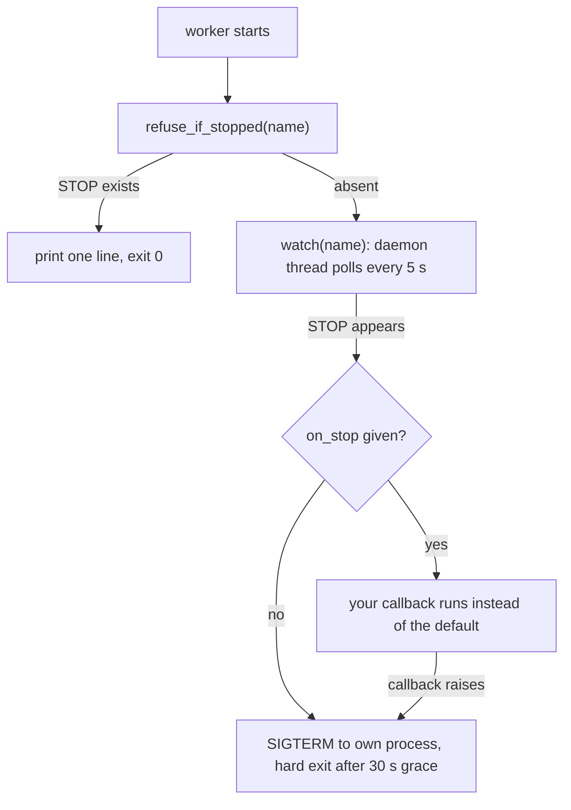

# stop_latch

One shared `STOP` file. While it exists, workers that call the library refuse to start and running workers are told to stop. Delete the file to allow work again. Reference and every limit: [stop_latch/README.md](../stop_latch/README.md).



## API

| Call | What it does |
|---|---|
| `stop_latch.stop_present(path=None)` | plain `stat` check; `True` if the STOP file (or a symlink at that path) exists |
| `stop_latch.refuse_if_stopped(name, path=None)` | entry check for one-shot commands: prints a line and exits 0 if STOP exists |
| `stop_latch.watch(name, interval=5.0, path=None, on_stop=None, grace=None)` | starts one daemon watcher thread per `name`; returns the thread |
| `stop_latch.enforce(name, interval=5.0, path=None)` | `refuse_if_stopped` plus `watch`: the standard call for a daemon |
| `python3 stop_latch.py` | prints `STOP present` or `STOP absent` for the path in force |

Where the file lives: `STOP_LATCH_FILE` (exact path) wins over `STOP_LATCH_ROOT` (folder), which wins over the default (`STOP` in the parent of the folder holding `stop_latch.py`). Set one of them for every worker and for the person who creates the file.

## How to plug in your own

**1. Use it in a worker.** Copy `scripts/stop_latch.py` next to your code (or put `scripts/` on `PYTHONPATH`) and call `enforce` at the top of the worker:

```python
import stop_latch
stop_latch.enforce("my-worker")
```

**2. Pick your own STOP location.** Export the same variable in every worker and in your shell:

```bash
export STOP_LATCH_FILE=/var/run/myapp/STOP     # exact file
touch "$STOP_LATCH_FILE"                       # stop everything that calls the library
rm "$STOP_LATCH_FILE"                          # allow work again
```

**3. Run your own shutdown instead of SIGTERM.** Pass `on_stop`. The callback replaces the default reaction, so it must make your worker end by itself (a callback that only raises falls back to the default stop). This example was run on 2026-11-21: with STOP created one second after start it prints the two lines below and exits 0.

```python
import sys, threading
sys.path.insert(0, "path/to/agent-guardrails/stop_latch/scripts")
import stop_latch

stopping = threading.Event()

def on_stop():
    print("STOP seen: finishing the current item, then exiting")
    stopping.set()

stop_latch.refuse_if_stopped("demo-worker")                   # exits 0 at start-up while STOP exists
stop_latch.watch("demo-worker", interval=0.1, on_stop=on_stop)
while not stopping.wait(0.1):                                 # your real work loop goes here
    pass
print("clean shutdown")
```

```
STOP seen: finishing the current item, then exiting
clean shutdown
```

**4. Non-Python workers.** Check for the file yourself at start-up and in your loop (`[ -e "$STOP_LATCH_FILE" ] && exit 0`); the latch is only a file.

Remember: it is cooperative and same-machine. A process that never calls it ignores it, and anyone who can create the file can stop your workers.
