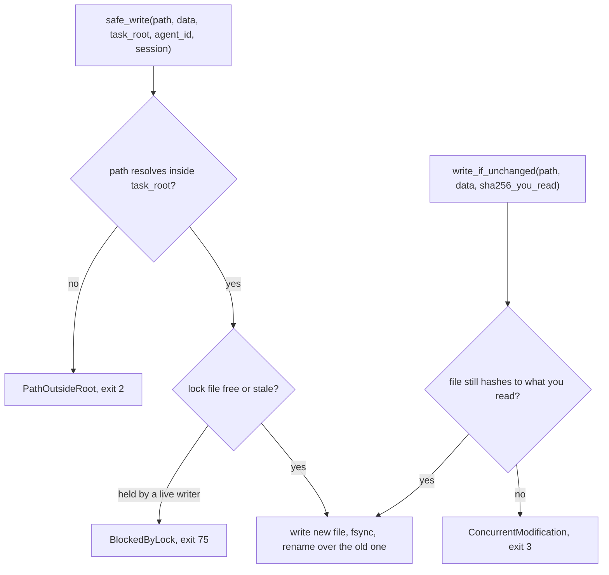

# write_guards

Small tools that turn silent write failures (last writer wins, sync conflict copies, a mocked process id reaching `os.kill`) into loud, early, retryable errors. Reference and every limit: [write_guards/README.md](../write_guards/README.md).



## Modules

| Module | Public calls | Command line |
|---|---|---|
| `write_guard.py` | `safe_write`, `safe_append`, `acquire`, `release`, `touch`, `check_in_root`, `lock_status`, `reclaim_stale`; exceptions `BlockedByLock`, `PathOutsideRoot` | `write`, `append`, `lock-status`, `reclaim-stale`; exit 0 ok, 2 refused, 75 blocked |
| `guarded_write.py` | `sha256_of`, `write_if_unchanged`; exceptions `ConcurrentModification`, `UnsafeLockDirectory` | `hash FILE`, `write FILE --expect <sha256>` (exit 3 if changed), `--expect missing` for a new file |
| `host_paths.py` | `host_name`, `per_host`, `resolve` | none (library) |
| `signal_guard.py` | `install`, `blocked_reason` | none; `install_signal_guard.sh` is the opt-in persistent installer |

## How to plug in your own

**1. Guard your own writer.** Copy `scripts/` into your project. Replace direct file writes with `safe_write` (lock plus root check) or `write_if_unchanged` (compare-and-swap). This example was run on 2026-11-21 and printed the two `refused:` lines and the last line:

```python
import sys
sys.path.insert(0, "path/to/agent-guardrails/write_guards/scripts")
import write_guard, guarded_write, host_paths

root = "/work/myproject"                      # the folder your agent may write in
write_guard.safe_write(root + "/out.txt", "hello\n", task_root=root, agent_id="me", session="s1")
try:
    write_guard.safe_write("/etc/x", "no", task_root=root, agent_id="me", session="s1")
except write_guard.PathOutsideRoot as e:
    print("refused:", type(e).__name__)         # refused: PathOutsideRoot

sha = guarded_write.sha256_of(root + "/out.txt")        # read, remember the hash
guarded_write.write_if_unchanged(root + "/out.txt", b"v2\n", sha)
try:
    guarded_write.write_if_unchanged(root + "/out.txt", b"v3\n", sha)   # stale hash
except guarded_write.ConcurrentModification as e:
    print("refused:", type(e).__name__)         # refused: ConcurrentModification
print(host_paths.per_host("data/LATEST.json", host="boxa"))   # data/LATEST.boxa.json
```

`safe_write(path, data, task_root, agent_id, session, root=None, ttl_s=300)` keeps its lock under `<root>/data/locks` (`root` defaults to `task_root`); pass a separate `root` so locks are not inside the folder you protect. Handle `BlockedByLock` by waiting and retrying: it is an expected, retryable condition.

**2. Per-host names.** For a file that several computers write into a synced folder, call `host_paths.per_host("data/LATEST.json")` to get `data/LATEST.<host>.json`, and `host_paths.resolve(root, "data/LATEST.json")` to read this host's file with a fallback to the shared one. Set `HOST_PATHS_HOST` to choose the name yourself.

**3. Signal guard in your test runner.** Call `signal_guard.install()` from your test runner, `conftest.py` or `sitecustomize` (it only acts while `unittest` is imported). The persistent installer `install_signal_guard.sh` is opt-in and has a documented code-execution risk; read its section in the [component README](../write_guards/README.md) first.

**4. From shell scripts.** Use the command line (`write_guard.py write --path ... --task-root ...`, `guarded_write.py hash/write`) and branch on the exit codes above.

Limits worth repeating: locks protect only writers that use them, they are not distributed locks, and a lock-folder trust check is tested on macOS only.
